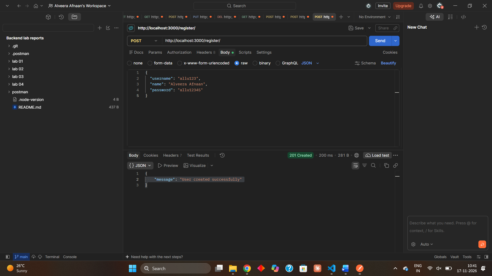
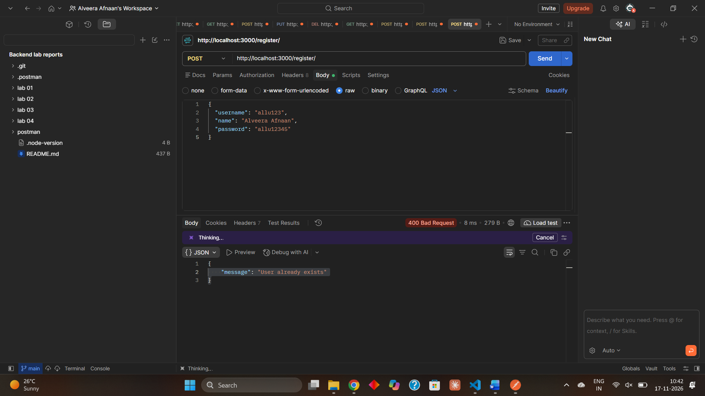
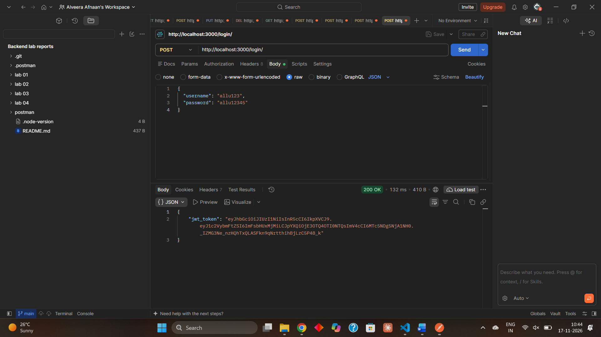
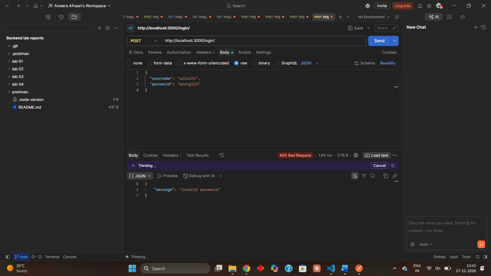
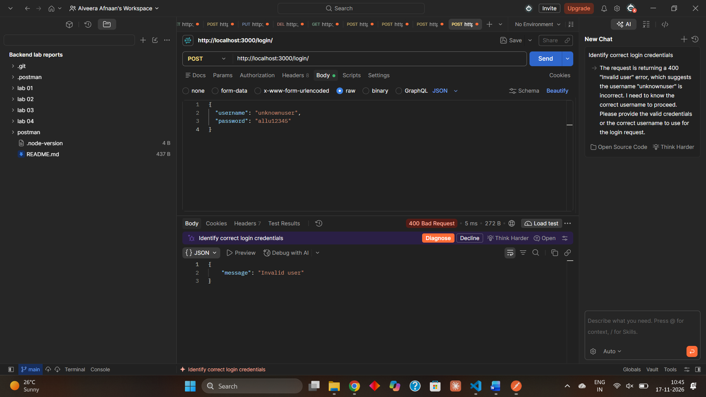
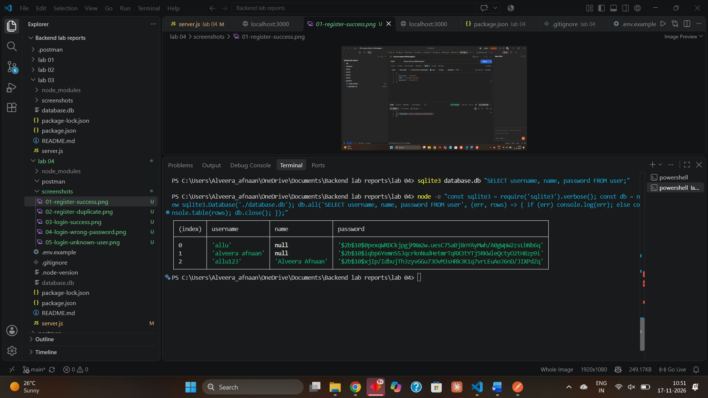

# Lab 04: Registration, Login and JWT Authentication

## Student Information

| Field               | Details                          |
| ------------------- | -------------------------------- |
| Name                | Alveera Afnaan                   |
| Registration Number | 252U1R1237                       |
| Section             | CSE-2E 211                       |
| Course              | Backend Development Fundamentals |
| Faculty             | Mr Yugandhar Gurjalwar           |
| College             | Aurora Deemed-to-be-University   |

---

## Objective

To implement user registration and login functionality in an Express.js REST API using SQLite database integration.

The main objectives are:

- Register new users.
- Prevent duplicate usernames.
- Securely hash passwords using bcrypt.
- Authenticate users during login.
- Generate JSON Web Tokens (JWT) after successful login.
- Use parameterized SQL queries to prevent SQL injection.
- Maintain the existing book management APIs.

---

## Technologies Used

| Technology   | Purpose                |
| ------------ | ---------------------- |
| Node.js      | JavaScript runtime     |
| Express.js   | Backend web framework  |
| SQLite       | Database management    |
| sqlite3      | SQLite database driver |
| bcrypt       | Password hashing       |
| jsonwebtoken | JWT generation         |
| Postman      | API testing            |
| Git & GitHub | Version control        |
| Render       | Cloud deployment       |

---

## Database Structure

**Database File:** `database.db`

### 1. User Table

Stores registered user information.

| Column   | Type    | Description     |
| -------- | ------- | --------------- |
| id       | INTEGER | Primary key     |
| username | TEXT    | Unique username |
| name     | TEXT    | Full name       |
| password | TEXT    | Hashed password |

Passwords are stored using bcrypt hashing instead of plain text.

### 2. Book Table

Maintains the book records from previous labs.

| Column | Type    | Description     |
| ------ | ------- | --------------- |
| id     | INTEGER | Primary key     |
| title  | TEXT    | Book title      |
| author | TEXT    | Author name     |
| price  | INTEGER | Book price      |
| pages  | INTEGER | Number of pages |

---

## Installation and Setup

### Prerequisites

- Node.js
- npm
- VS Code

### Steps

1. Clone the repository:

```bash
git clone https://github.com/alveeraafnaan/Backend-lab-reports-.git
```

2. Navigate to the Lab 04 folder:

```bash
cd "Backend-lab-reports-/lab 04"
```

3. Install dependencies:

```bash
npm install
```

4. Start the server:

```bash
node server.js
```

5. Open the application:

```text
http://localhost:3000/
```

---

## API Endpoints

| Method | Endpoint          | Description                                  |
| ------ | ----------------- | -------------------------------------------- |
| GET    | `/`               | Displays student details and API information |
| POST   | `/register/`      | Registers a new user                         |
| POST   | `/login/`         | Authenticates a user and generates JWT       |
| GET    | `/books/`         | Retrieves all books                          |
| GET    | `/books/:bookId/` | Retrieves a specific book                    |
| POST   | `/books/`         | Adds a new book                              |
| PUT    | `/books/:bookId/` | Updates a book                               |
| DELETE | `/books/:bookId/` | Deletes a book                               |

---

## User Registration

**Endpoint:** `POST /register/`

Sample request:

```json
{
  "username": "allu123",
  "name": "Alveera Afnaan",
  "password": "allu12345"
}
```

Successful response:

```json
{
  "message": "User created successfully"
}
```

Duplicate username response:

```json
{
  "message": "User already exists"
}
```

---

## User Login

**Endpoint:** `POST /login/`

Sample request:

```json
{
  "username": "allu123",
  "password": "allu12345"
}
```

Successful response:

```json
{
  "jwt_token": "generated_jwt_token"
}
```

Invalid username response:

```json
{
  "message": "Invalid user"
}
```

Invalid password response:

```json
{
  "message": "Invalid password"
}
```

---

## Password Security

Passwords are protected using bcrypt.

- `bcrypt.hash()` converts the original password into a secure hash.
- The database stores the hashed password.
- `bcrypt.compare()` checks the entered password during login.
- Original passwords are not stored in the database.

---

## JSON Web Token (JWT)

JWT is used to generate an authentication token after successful login.

The token contains the username and token timestamps.

Example payload:

```json
{
  "username": "allu123",
  "iat": 1794900000,
  "exp": 1794903600
}
```

The password is not included in the JWT payload.

Token generation uses `jwt.sign()` with a secret key and an expiration time.

---

## Screenshots

All screenshots are stored in the `screenshots` folder.

### 1. Successful User Registration


### 2. Duplicate User Registration


### 3. Successful Login


### 4. Login with Incorrect Password


### 5. Login with Unknown Username


### 6. SQLite Database Showing Hashed Password



## Problems Faced and Solutions

| Problem                                              | Solution                                                     |
| ---------------------------------------------------- | ------------------------------------------------------------ |
| Existing book table did not contain the pages column | Added a database migration to add the missing column         |
| Existing user table did not contain the name column  | Added a database migration to add the missing column         |
| SQLite command was not recognized in PowerShell      | Used Node.js and the sqlite3 package to inspect the database |
| Password security                                    | Implemented bcrypt hashing                                   |
| Authentication                                       | Implemented JWT token generation                             |

---

## Viva Questions and Answers

**1. What is bcrypt?**

Bcrypt is a password-hashing library used to securely store passwords.

**2. What is JWT?**

JWT stands for JSON Web Token. It is used to securely transfer information between parties.

**3. What is password hashing?**

Password hashing converts a password into a fixed-length string that cannot be reversed to recover the original password.

**4. Why do we use POST for login?**

POST sends login information in the request body instead of exposing credentials in the URL.

**5. What is the purpose of jwt.sign()?**

It generates a signed JWT using a payload and a secret key.

**6. What is a parameterized query?**

It separates SQL commands from user input and helps prevent SQL injection.

---

## Conclusion

In this lab, I learned how to implement user registration and login using Node.js, Express.js, and SQLite.

I also learned password hashing with bcrypt, JWT generation, database integration, and API testing using Postman.

This lab helped me understand authentication and basic backend security concepts.

---

## Author

**Alveera Afnaan**
Registration Number: 252U1R1237
Aurora Deemed-to-be-University
